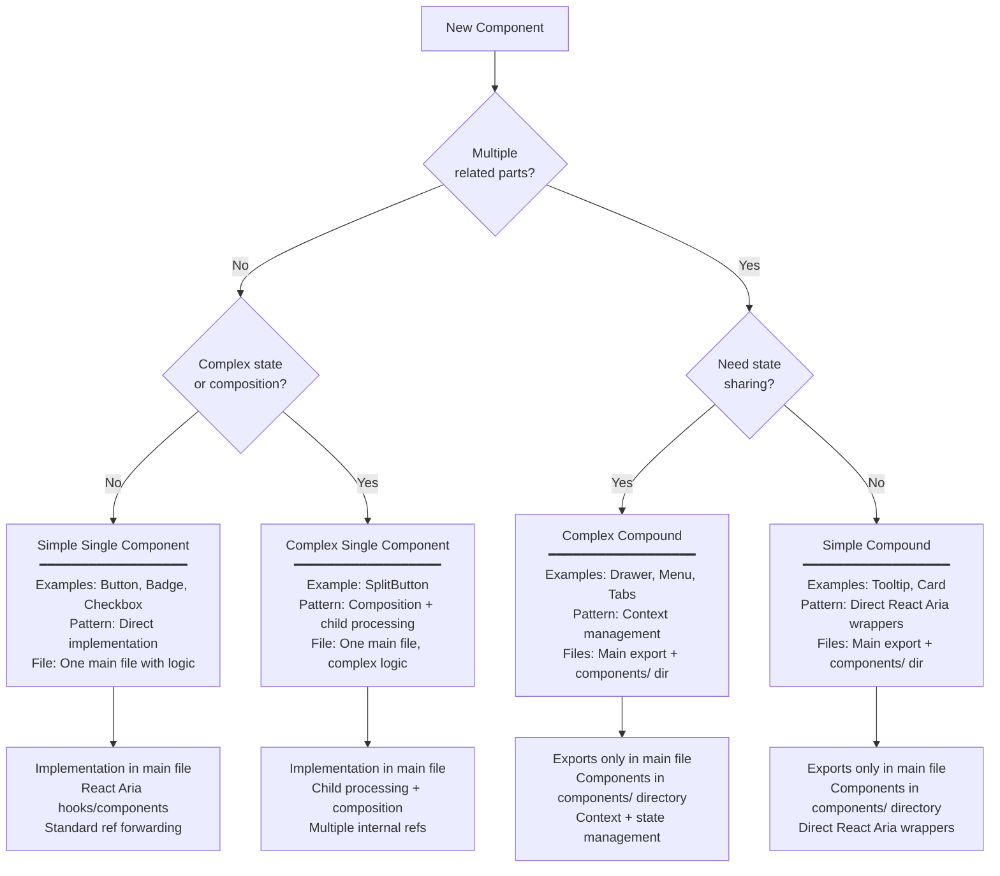
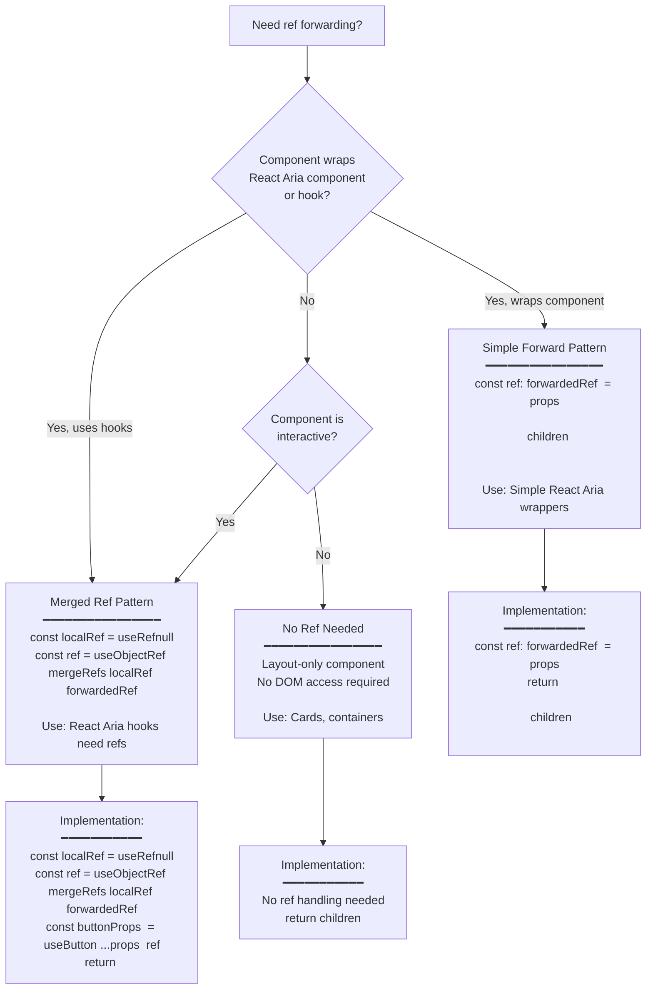
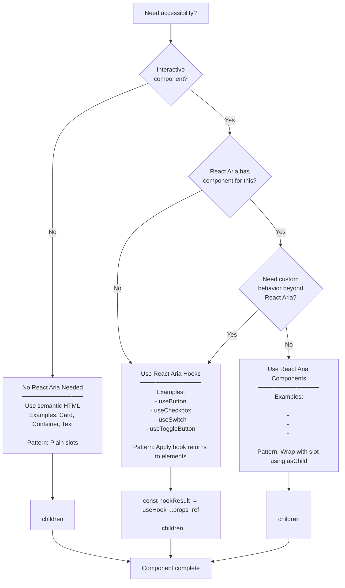
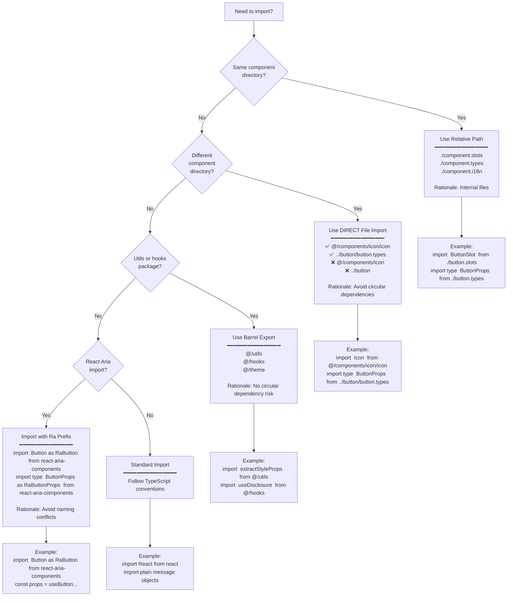

# Decision Flows

## Decision Flows

Use these decision flows to determine the correct patterns for your component:

### Flow 1: Component Architecture Decision

**Key Questions:**

- Multiple parts? → Compound
- Parts need coordination? → Complex Compound
- Single element? → Single
- Complex logic? → Complex Single

---

### Flow 2: Ref Forwarding Pattern Decision

**When to Use Each Pattern:**

- **Merged Ref**: React Aria hooks (useButton, useCheckbox) need refs
- **Simple Forward**: Wrapping React Aria components
- **No Ref**: Layout components without DOM interaction

---

### Flow 3: React Aria Integration Decision

**Decision Criteria:**

- **No React Aria**: Layout-only components (Card, Container)
- **React Aria Components**: Standard interactive elements with no custom logic
- **React Aria Hooks**: Need custom behavior or React Aria doesn't have
  component

---

### Flow 4: Import Strategy Decision

**Import Strategy Summary:** | Location | Pattern | Reason |
|----------|---------|--------| | Same directory | Relative (`./file`) |
Internal files | | Other component | Direct file (`@/components/name/name`) |
Avoid circular deps | | Utils/hooks | Barrel (`@/utils`) | Safe for barrel
exports | | React Aria | Ra prefix (`as RaButton`) | Avoid name conflicts |

---
