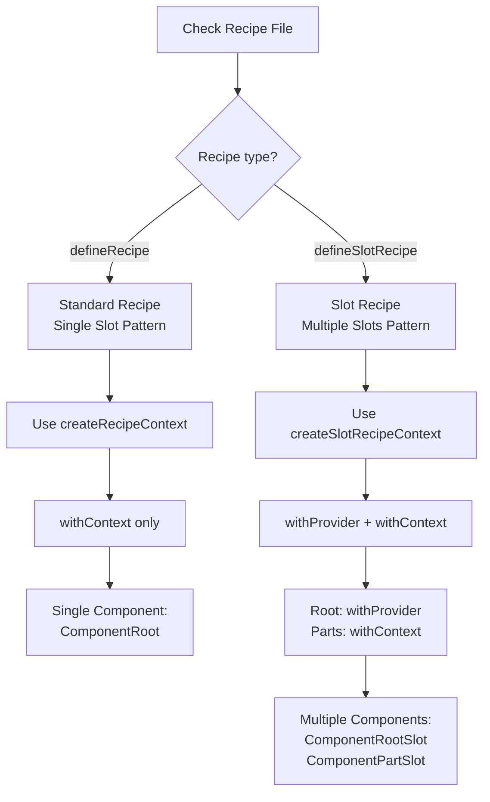

# Writing Slots Skill

You are a Nimbus slot component specialist. This skill helps you create, update,
or validate slot component files (`{component}.slots.tsx`) that bridge React
Aria components with the Nimbus Chakra UI v3 styling system.

## Critical Requirements

**Slot components inject recipe styling into React components.** They MUST
export both components AND types, use explicit return type annotations with
`SlotComponent` utility, and integrate properly with recipes.

## Mode Detection

Parse the request to determine the operation:

- **create** - Generate new slot components file
- **update** - Add new slots, enhance existing slots
- **validate** - Check slot components compliance with guidelines

If no mode is specified, default to **create**.

## Required Research (All Modes)

Do not read whole guideline files. Read only the sections listed here. To find a section, run `rg -n '^## ' <file>` for its line numbers, then use the Read tool with `offset` and `limit`.

**Before implementation, read these sections:**

1. `docs/file-type-guidelines/slots.md`, sections `## Critical Requirements` and `## SlotComponent Utility Type`
2. `docs/naming-conventions.md`, section `## Slot Name Mapping (CRITICAL)`
3. **Analyze** recipe slot definitions:

   ```bash
   cat packages/nimbus/src/components/{component}/{component}.recipe.ts
   ```

4. **Review** similar slot implementations:
   ```bash
   ls packages/nimbus/src/components/*/*.slots.tsx
   ```

**Read these sections only when the task needs them:**

| Task | Section to read |
| --- | --- |
| File layout, context, React Aria, and type patterns | `reference/patterns.md` |
| Naming slots and recipes | `docs/naming-conventions.md`, `## Recipe and Slot Naming` |
| Common patterns | `docs/file-type-guidelines/slots.md`, `## Common Patterns from Nimbus` |

---

## Slot Type Decision Flow

Use this diagram to determine which slot pattern to use:



## Slot Type Decision Matrix

### Standard Recipe (Single Slot)

**When:**

- Component has single visual element
- Uses `defineRecipe` in recipe file
- Simple styling needs

**Pattern:**

```typescript
const { withContext } = createRecipeContext({ recipe });
export const ComponentRoot = withContext("element", "root");
```

**Examples:** Button, Badge, Avatar

### Slot Recipe (Multiple Slots)

**When:**

- Component has multiple coordinated visual elements
- Uses `defineSlotRecipe` in recipe file
- Complex multi-element styling

**Pattern:**

```typescript
const { withProvider, withContext } = createSlotRecipeContext({ recipe });
export const ComponentRootSlot = withProvider("element", "root");
export const ComponentPartSlot = withContext("element", "part");
```

**Examples:** Menu, Input, Card, Dialog

## Mandatory Export Requirements (CRITICAL)

### MUST Export Both Components AND Types

**This is non-negotiable:**

```typescript
// ✅ CORRECT - Export both type and component
export type ButtonRootProps = HTMLChakraProps<"button">;
export const ButtonRoot: SlotComponent<HTMLButtonElement, ButtonRootProps> =
  withContext<HTMLButtonElement, ButtonRootProps>("button", "root");

// ❌ INCORRECT - Missing type export
export const ButtonRoot = withContext("button", "root");

// ❌ INCORRECT - Missing explicit return type annotation
export type ButtonRootProps = HTMLChakraProps<"button">;
export const ButtonRoot = withContext<HTMLButtonElement, ButtonRootProps>(
  "button",
  "root"
);
```

### Type Name MUST Equal Component Name + "Props"

| Component Name    | Type Name              | ✅/❌ |
| ----------------- | ---------------------- | ----- |
| `ButtonRoot`      | `ButtonRootProps`      | ✅    |
| `MenuTriggerSlot` | `MenuTriggerSlotProps` | ✅    |
| `ButtonRoot`      | `ButtonProps`          | ❌    |
| `MenuTriggerSlot` | `MenuTrigger`          | ❌    |

## SlotComponent Utility Type (CRITICAL)

**ALL slot component exports MUST include explicit return type annotation:**

```typescript
import type { SlotComponent } from "@/type-utils";

export const ComponentSlot: SlotComponent<TElement, TProps> = withContext<
  TElement,
  TProps
>("element", "slot");
```

### Why This Is Required

- TypeScript infers return types from `withProvider`/`withContext` that
  reference Chakra's internal generated types
- These inferred types create non-portable references to
  `node_modules/@chakra-ui/react/dist/types/styled-system/generated/recipes.gen`
- During declaration file (`.d.ts`) generation, this causes TS2742 errors
- Explicit return type annotations using `SlotComponent` create stable, portable
  types

### Type Definition

```typescript
// packages/nimbus/src/type-utils/slot-types.ts
export type SlotComponent<
  TElement = Element,
  TProps = Record<string, unknown>,
> = React.ForwardRefExoticComponent<
  React.PropsWithoutRef<TProps> & React.RefAttributes<TElement>
>;
```

## File Structure Patterns

For file layout, context, React Aria integration, and type patterns, read the matching section in `reference/patterns.md`. List its sections with `rg -n '^##' .claude/skills/writing-slots/reference/patterns.md`.

## Naming Conventions (CRITICAL)

You MUST follow naming conventions from `docs/naming-conventions.md`, including:

- **Single-slot:** `{Component}Root`, `{Component}RootProps`
- **Multi-slot:** `{Component}{Part}Slot`, `{Component}{Part}SlotProps`
- **Slot names** must match recipe slot definitions exactly

See `docs/file-type-guidelines/slots.md` for complete slot patterns.

## Create Mode

### Step 1: Determine Recipe Type

Check the recipe file:

```typescript
// Standard recipe?
export const componentRecipe = defineRecipe({ ... });

// Slot recipe?
export const componentSlotRecipe = defineSlotRecipe({
  slots: ['root', 'part1', 'part2'],
  ...
});
```

### Step 2: Import Required Types

```typescript
import {
  createRecipeContext, // or createSlotRecipeContext
  type HTMLChakraProps,
} from "@chakra-ui/react/styled-system";
import { componentRecipe } from "./component.recipe"; // Import recipe
import type { SlotComponent } from "@/type-utils"; // MUST import
```

### Step 3: Create Context

**For standard recipe:**

```typescript
const { withContext } = createRecipeContext({
  recipe: componentRecipe,
});
```

**For slot recipe:**

```typescript
const { withProvider, withContext } = createSlotRecipeContext({
  recipe: componentSlotRecipe,
});
```

### Step 4: Create Slot Components

**For standard recipe (single slot):**

```typescript
export type ComponentRootProps = HTMLChakraProps<"element">;
export const ComponentRoot: SlotComponent<HTMLElementType, ComponentRootProps> =
  withContext<HTMLElementType, ComponentRootProps>("element", "root");
```

**For slot recipe (multiple slots):**

```typescript
// Root (provider)
export type ComponentRootSlotProps = HTMLChakraProps<"div">;
export const ComponentRootSlot: SlotComponent<
  HTMLDivElement,
  ComponentRootSlotProps
> = withProvider<HTMLDivElement, ComponentRootSlotProps>("div", "root");

// Each part (consumer)
export type ComponentPartSlotProps = HTMLChakraProps<"span">;
export const ComponentPartSlot: SlotComponent<
  HTMLSpanElement,
  ComponentPartSlotProps
> = withContext<HTMLSpanElement, ComponentPartSlotProps>("span", "part");
```

### Step 5: Verify Element and Slot Names

- Element type MUST match HTML element (`"button"`, `"div"`, etc.)
- Slot name MUST match recipe slots array
- TypeScript generic MUST match HTML element type (`HTMLButtonElement`,
  `HTMLDivElement`, etc.)

## Update Mode

### Process

1. You MUST read existing slots file
2. You MUST check recipe file for slot definitions
3. You SHOULD preserve existing structure
4. You MUST add explicit return type annotations if missing
5. You MUST export types if missing

### Common Updates

- **Add new slot** - Add to multi-slot component
- **Fix type exports** - Add missing type exports
- **Add return type annotations** - Add `SlotComponent` annotations
- **Update element types** - Change HTML element type
- **Fix naming** - Correct component/type names

## Validate Mode

### Validation Checklist

Run every item in `reference/validation-checklist.md`. Record each violation with its file and line. Write the report using `reference/validation-report.md`.

## Error Recovery

If validation fails:

1. You MUST check SlotComponent imports
2. You MUST verify type exports exist
3. You MUST ensure return type annotations present
4. You MUST confirm slot names match recipe
5. You MUST validate element types match generics
6. You SHOULD rebuild to verify type generation

## Reference Examples

Use the examples in `reference/examples.md` that match the number of slots in the component.

## RFC 2119 Key Words

MUST means required, SHOULD means recommended, and MAY means optional, as defined in [RFC 2119](https://www.ietf.org/rfc/rfc2119.txt). The full table is in `reference/rfc-2119.md`.

---

**Execute slot components operation for: $ARGUMENTS**
