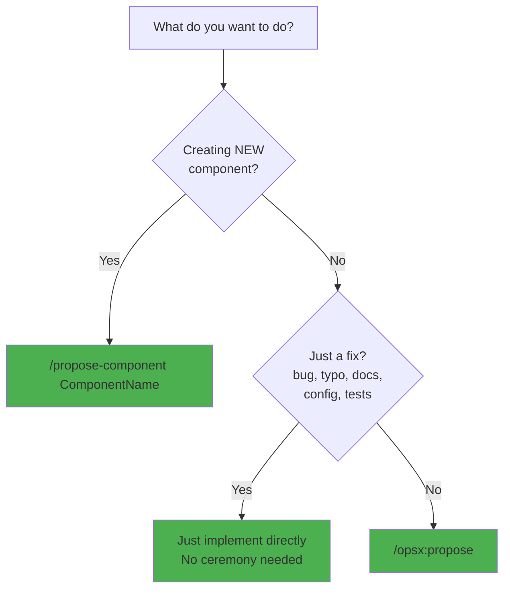

## Quick Start: What Do You Want To Do?

Choose the command that matches your task:



**90% of the time, you need ONE of these:**

- **Creating a component?** → `/propose-component ComponentName`
- **Just a fix?** → Just implement directly (no ceremony)
- **Everything else?** → `/opsx:propose`

## Common Workflows

### Creating a New Component

Use the `/propose-component` command:

```
/propose-component Toast
```

This command will:

1. Invoke `/brainstorm` to clarify requirements
2. Validate against Nimbus standards
3. Create an OpenSpec proposal
4. Generate implementation tasks with TDD approach
5. Coordinate nimbus-coder to implement all required files
6. Invoke nimbus-reviewer to validate compliance

### Fixing a Bug or Refactoring a Pattern

Just implement the fix directly:

```
Read the file, understand the issue, make the change, test it.
No OpenSpec proposal needed for bug fixes.
```

**Important: Keep docs and tooling in sync.** When you change a pattern (file
structure, naming convention, code style, template format, etc.), check whether
that pattern is documented or codified anywhere else and update those locations
too. Common places patterns are referenced:

- **Skills** (`.claude/skills/`) — templates and validation checklists
- **Commands** (`.claude/commands/`) — step-by-step instructions and examples
- **Guidelines** (`docs/file-type-guidelines/`) — documented conventions
- **Templates** (`docs/component-templates/`, `docs/engineering-docs-template*`)

A pattern change is not complete until all references to the old pattern are
updated.

When updating those references, state the new requirement positively. You SHOULD
NOT add a prohibition against the pattern you just removed: once it is gone from
the templates a reader will not invent it, and describing it teaches a dead
pattern to people who would otherwise never encounter it. Deleting it is enough.

Warn against something only when a reader would plausibly reach for it anyway —
it is a common habit outside this repo (e.g. barrel imports from
`@chakra-ui/react`), an older pattern still present elsewhere in the codebase,
or, in designer-facing docs, a component someone could reasonably pick for the
wrong job.

### Updating Documentation

Use the `/create-eng-docs` command:

```
/create-eng-docs Button
```

This creates both `.dev.mdx` and `.docs.spec.tsx` files with comprehensive
documentation.

### Any Other Change

Use the `/opsx:propose` command:

```
/opsx:propose
```

Any change that isn't a fix requires a proposal. This includes but is not
limited to: architecture changes, breaking API changes, new features,
cross-cutting concerns, performance optimizations, and semantic decisions that
expand what the library accepts as valid input.

## Understanding How It Works (Optional)

### The Command → Agent → Skill Pipeline

**Commands** orchestrate complete workflows:

- `/propose-component` handles the full component creation process
- `/create-eng-docs` generates documentation
- `/opsx:propose` creates change proposals

**Agents** handle multi-step phases (typically invoked BY commands):

- `nimbus-researcher` - Gathers documentation and patterns
- `nimbus-coder` - Implements features following guidelines
- `nimbus-reviewer` - Validates against Nimbus standards

**Skills** create specific file types (invoked by agents OR directly):

- `writing-types` - TypeScript type definitions
- `writing-stories` - Storybook stories with play functions
- `writing-recipes` - Chakra UI styling recipes
- `writing-slots` - Slot component wrappers
- `writing-developer-documentation` - Engineering docs
- `writing-designer-documentation` - Designer docs
- `writing-i18n` - Internationalization files
- `brainstorm` - Design exploration

**When to invoke directly:**

- **Commands**: Always (your main interface)
- **Agents**: Rarely (only for custom workflows)
- **Skills**: Sometimes (when updating single file types)

### When to Use OpenSpec

**An OpenSpec proposal is the default for any change that is not a fix.**

**Use `/propose-component`** for NEW UI components:

- Creates OpenSpec proposal + Nimbus component standards
- Validates against WCAG, React Aria, Chakra UI patterns
- Generates TDD task list with acceptance criteria

**Use `/opsx:propose`** for all other non-fix changes.

**Skip OpenSpec only for:**

- Bug fixes (restoring intended behavior)
- Typos, formatting, comments
- Documentation updates (documenting existing/spec'd behavior)
- Test additions for existing behavior
- Dependency updates (non-breaking)

## OpenSpec Proposal Guidance

Every change needs a reason. If the change is not a fix (bug fix, typo, config
tweak, docs for existing behavior, or test for existing behavior), it SHOULD
have an OpenSpec proposal via `/opsx:propose` before implementation.

## Project Overview

Nimbus is a multi-package design system monorepo containing React UI components,
design tokens, icons, and documentation. It uses pnpm workspaces and is built
with TypeScript, React Aria Components, and Chakra UI v3.

**Key Architecture:**

- **Monorepo Structure**: Uses pnpm workspaces with packages and apps
  directories
- **Component Library**: React components with WCAG 2.1 AA compliant
  implementation using React Aria patterns
- **Design System**: Design token-based theming system with Chakra UI v3 recipes
- **Internationalization**: Compile-time message compilation using
  `@internationalized/string` with `LocalizedStringDictionary` and Transifex
  support
- **Documentation**: JSDoc-extracted API documentation site and Storybook for
  component development

## Package Execution

Always use `pnpx` or `pnpm exec` instead of `npx` to execute packages:

```bash
pnpx tsx script.ts
pnpm exec prettier --write .
```

## Development Commands

The most-used commands are below. Every command, with explanations, is in `docs/dev-commands.md`.

```bash
pnpm install                                        # install dependencies
pnpm start                                          # docs site and Storybook
pnpm test:dev <files>                               # tests against source (use for TDD)
pnpm --filter @commercetools/nimbus typecheck:dev   # typecheck against source (matches your editor)
pnpm typecheck:strict                               # CI gate: typecheck against the built dist (needs a prior build)
pnpm lint                                           # lint all files
```

## Code Architecture

### Package Structure

- **packages/nimbus**: Core UI component library with React Aria Components
- **packages/tokens**: Design tokens (colors, spacing, typography, animations)
- **packages/nimbus-icons**: SVG icons wrapped as React components (Material
  Icons + custom)
- **packages/color-tokens**: Brand-specific color definitions
- **packages/i18n**: Translation messages and internationalization support
- **apps/docs**: Documentation SPA with interactive examples and auto-generated
  content

### Chakra UI Imports (CRITICAL)

**NEVER use barrel imports from `@chakra-ui/react`.** Always use modular subpath
imports to avoid pulling in the entire component library:

```typescript
// ✅ Correct - modular imports
import { defineRecipe, HTMLChakraProps } from "@chakra-ui/react/styled-system";
import { Box } from "@chakra-ui/react/box";
import { Steps } from "@chakra-ui/react/steps";
import { useBreakpointValue } from "@chakra-ui/react/hooks";
import { mergeRefs } from "@/utils"; // local utility, not from Chakra

// ❌ WRONG - barrel import loads every component
import { defineRecipe, Box, mergeRefs } from "@chakra-ui/react";
```

### Component Development

For comprehensive component development guidance, see:

- Component Guidelines: `./docs/component-guidelines.md`
- Architecture Decisions:
  `./docs/file-type-guidelines/architecture-decisions.md`
- File Review Protocol: `./docs/file-review-protocol.md`

## MCP Server Tools

This project includes integrated MCP (Model Context Protocol) tooling that
provides automated development workflows. Leverage these tools for automated
tasks:

### Available MCP Servers

- **context7**: Primary interface for querying library documentation for React
  Aria, Chakra UI, and other libraries before implementing features.
- **playwright**: Browser automation for visual testing and web interaction to
  verify UI changes and test user flows.
- **sequential-thinking**: For complex planning and multi-step reasoning when
  tackling large features or architecture design decisions that require
  systematic analysis.

### Usage Guidelines

- **Always** use context7 to find relevant documentation before implementing new
  components or patterns
- **Proactively** use playwright to visually verify UI changes and capture
  screenshots for documentation
- **Leverage** sequential-thinking for breaking down complex tasks into
  manageable steps
- These tools are pre-configured and ready to use - no additional setup required

### Agent-Driven Development Workflow

**Use specialized agents proactively in an iterative cycle for all component
development:**

1. **Research Phase** (nimbus-researcher): Gather requirements, patterns,
   library documentation, and architectural guidance before writing any code
2. **Implementation Phase** (nimbus-coder): Write code strictly according to the
   guidelines and patterns identified in research
3. **Review Phase** (nimbus-reviewer): Validate code compliance against Nimbus
   standards and guidelines
4. **Iteration**: If review identifies non-compliance or improvement areas,
   return to implementation phase and repeat until all standards are met

Invoke agents autonomously when task complexity warrants it - don't wait for
explicit user requests. The goal is to leverage automation intelligently by
recognizing when a task's scope or requirements align with an agent's
capabilities.

## Development Workflow Best Practices

### Testing Strategy

The testing system uses Vitest with three distinct test categories:

| Category                          | File Pattern      | Purpose                                  | Audience     |
| --------------------------------- | ----------------- | ---------------------------------------- | ------------ |
| **Story Tests**                   | `*.stories.tsx`   | Internal component behavior testing      | Internal     |
| **Internal Unit Tests**           | `*.spec.tsx`      | Internal utility and hook testing        | Internal     |
| **Consumer Implementation Tests** | `*.docs.spec.tsx` | Documentation examples for consumer apps | **External** |

- **Story Tests**: Test component behavior with play functions in headless
  Chromium via Playwright. ALL component states, interactions, and a11y tested
  here.
- **Internal Unit Tests**: Fast JSDOM-based tests for utilities and hooks.
- **Consumer Implementation Tests**: Working code examples consumers can copy to
  test components in their apps. Injected into `.dev.mdx` docs at build time.

See [Testing Strategy Guide](./docs/file-type-guidelines/testing-strategy.md)
for detailed rules and examples.

Visual regression is handled separately by Chromatic in CI. Which stories get
snapshotted and why is in
[Chromatic Visual Regression: Authoring Stories](./docs/chromatic-visual-testing.md);
triggers, baselines, the manual full-snapshot run and merge gating are in the
[Chromatic CI Runbook](./docs/chromatic-ci.md).

### Git Conventions

See [Git Conventions](./docs/git-conventions.md) for branch naming, commit
message format, and test commands.

### Build Dependencies

Understanding build order is crucial:

1. **Design tokens** (`packages/tokens`) - Must build first
2. **Packages** (`packages/*`) - Depend on tokens
3. **Documentation** (`apps/docs`) - Depends on packages
4. **i18n compilation** - Translation data for runtime
