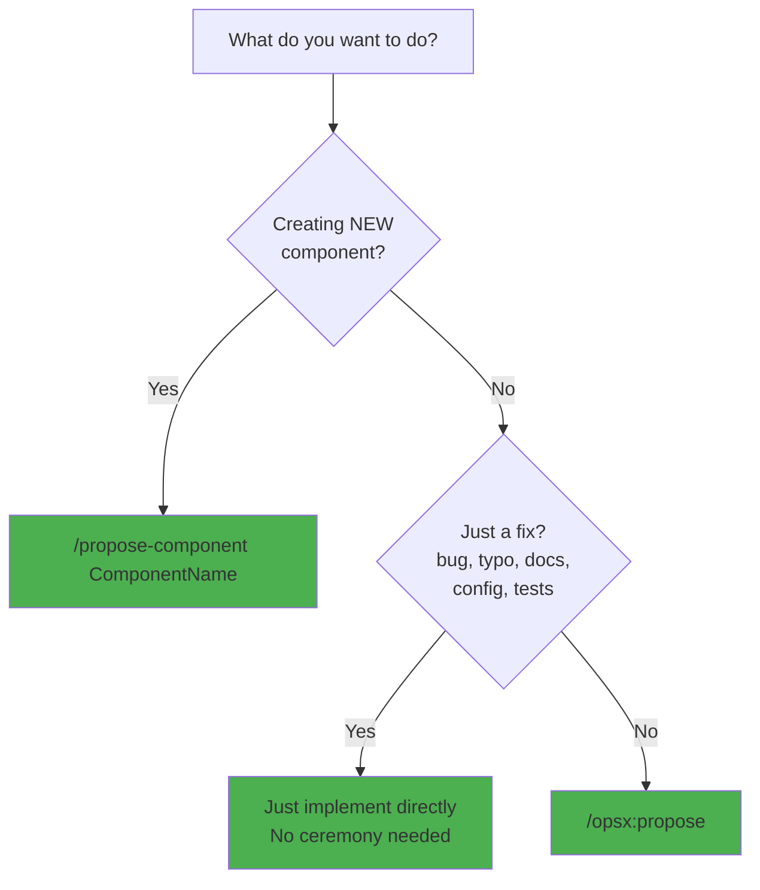

# Agent Workflow

## Quick Start: What Do You Want To Do?

Choose the command that matches your task:



**90% of the time, you need ONE of these:**

- **Creating a component?** → `/propose-component ComponentName`
- **Just a fix?** → Just implement directly (no ceremony)
- **Everything else?** → `/opsx:propose`

## Common Workflows

### Creating a New Component

Use the `/propose-component` command:

```
/propose-component Toast
```

This command will:

1. Invoke `/brainstorm` to clarify requirements
2. Validate against Nimbus standards
3. Create an OpenSpec proposal
4. Generate implementation tasks with TDD approach
5. Coordinate nimbus-coder to implement all required files
6. Invoke nimbus-reviewer to validate compliance

### Fixing a Bug or Refactoring a Pattern

Just implement the fix directly:

```
Read the file, understand the issue, make the change, test it.
No OpenSpec proposal needed for bug fixes.
```

**Important: Keep docs and tooling in sync.** When you change a pattern (file
structure, naming convention, code style, template format, etc.), check whether
that pattern is documented or codified anywhere else and update those locations
too. Common places patterns are referenced:

- **Skills** (`.claude/skills/`) — templates and validation checklists
- **Commands** (`.claude/commands/`) — step-by-step instructions and examples
- **Guidelines** (`docs/file-type-guidelines/`) — documented conventions
- **Templates** (`docs/component-templates/`, `docs/engineering-docs-template*`)

A pattern change is not complete until all references to the old pattern are
updated.

When updating those references, state the new requirement positively. You SHOULD
NOT add a prohibition against the pattern you just removed: once it is gone from
the templates a reader will not invent it, and describing it teaches a dead
pattern to people who would otherwise never encounter it. Deleting it is enough.

Warn against something only when a reader would plausibly reach for it anyway —
it is a common habit outside this repo (e.g. barrel imports from
`@chakra-ui/react`), an older pattern still present elsewhere in the codebase,
or, in designer-facing docs, a component someone could reasonably pick for the
wrong job.

### Updating Documentation

Use the `/create-eng-docs` command:

```
/create-eng-docs Button
```

This creates both `.dev.mdx` and `.docs.spec.tsx` files with comprehensive
documentation.

### Any Other Change

Use the `/opsx:propose` command:

```
/opsx:propose
```

Any change that isn't a fix requires a proposal. This includes but is not
limited to: architecture changes, breaking API changes, new features,
cross-cutting concerns, performance optimizations, and semantic decisions that
expand what the library accepts as valid input.

## Understanding How It Works (Optional)

### The Command → Agent → Skill Pipeline

**Commands** orchestrate complete workflows:

- `/propose-component` handles the full component creation process
- `/create-eng-docs` generates documentation
- `/opsx:propose` creates change proposals

**Agents** handle multi-step phases (typically invoked BY commands):

- `nimbus-researcher` - Gathers documentation and patterns
- `nimbus-coder` - Implements features following guidelines
- `nimbus-reviewer` - Validates against Nimbus standards

**Skills** create specific file types (invoked by agents OR directly):

- `writing-types` - TypeScript type definitions
- `writing-stories` - Storybook stories with play functions
- `writing-recipes` - Chakra UI styling recipes
- `writing-slots` - Slot component wrappers
- `writing-developer-documentation` - Engineering docs
- `writing-designer-documentation` - Designer docs
- `writing-i18n` - Internationalization files
- `brainstorm` - Design exploration

**When to invoke directly:**

- **Commands**: Always (your main interface)
- **Agents**: Rarely (only for custom workflows)
- **Skills**: Sometimes (when updating single file types)

### When to Use OpenSpec

**An OpenSpec proposal is the default for any change that is not a fix.**

**Use `/propose-component`** for NEW UI components:

- Creates OpenSpec proposal + Nimbus component standards
- Validates against WCAG, React Aria, Chakra UI patterns
- Generates TDD task list with acceptance criteria

**Use `/opsx:propose`** for all other non-fix changes.

**Skip OpenSpec only for:**

- Bug fixes (restoring intended behavior)
- Typos, formatting, comments
- Documentation updates (documenting existing/spec'd behavior)
- Test additions for existing behavior
- Dependency updates (non-breaking)

## OpenSpec Proposal Guidance

Every change needs a reason. If the change is not a fix (bug fix, typo, config
tweak, docs for existing behavior, or test for existing behavior), it SHOULD
have an OpenSpec proposal via `/opsx:propose` before implementation.
