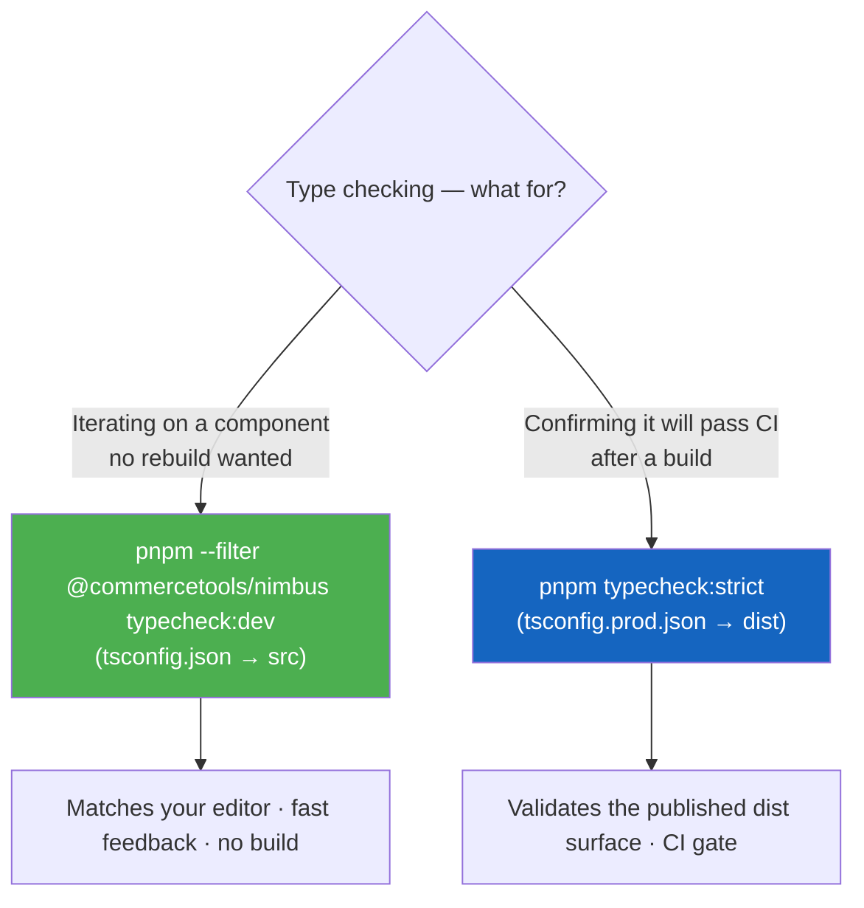

# Development Commands

## Development Commands

### Setup and Installation

```bash
# Full initialization (full reset + clean install + build + playwright setup)
pnpm nimbus:init

# Surgical clean: remove caches (.turbo, .swc, .cache, *.tsbuildinfo, coverage,
# storybook-static) and ORPHANED generated i18n (component dirs left with only
# intl/ + *.messages.ts after a branch switch — a common source of phantom
# cross-branch TypeScript errors). Keeps node_modules and live generated files,
# so the tree still typechecks immediately after. Run this first when a branch
# shows TS errors that don't match its source.
pnpm nimbus:clean

# Full reset: everything `nimbus:clean` does, plus ALL generated artifacts
# (generated i18n, material-icons, docs src/data, mcp data), every dist/, and
# node_modules. Requires a reinstall + rebuild afterward (that's what
# `nimbus:init` chains). Never touches the committed packages/tokens/src/generated
# tree or local config (.env*, .vscode/, .idea/). See scripts/clean.mjs.
pnpm nimbus:reset

# Install dependencies only
pnpm install

# Install Playwright browsers (one-time setup)
pnpm playwright:install
```

### Development Server

```bash
# Start both docs site and Storybook
pnpm start

# Start documentation site only (http://localhost:5173)
pnpm start:docs

# Start Storybook only (http://localhost:6006)
pnpm start:storybook
```

### Build Commands

```bash
# Full build (tokens -> packages -> docs)
pnpm build

# Build packages only
pnpm build:packages

# Build documentation site only
pnpm build:docs

# Build/Generate design tokens
pnpm build:tokens
# or
pnpm generate:tokens
```

### Internationalization (i18n)

```bash
# Extract messages from .i18n.ts files and compile
pnpm extract-intl

# Compile only (after downloading translations from Transifex)
pnpm --filter @commercetools/nimbus-i18n build
```

### Testing

```bash
# Run all tests (both unit and Storybook tests)
pnpm test

# Run only unit tests (JSDOM-based, fast)
pnpm test:unit

# Run only Storybook tests (browser-based, slower)
pnpm test:storybook

# Run all tests against source files (no build required, use for TDD)
pnpm test:dev

# Run only Storybook tests against source files (no build required)
pnpm test:storybook:dev

# Run specific test file
pnpm test packages/nimbus/src/components/button/button.spec.tsx
pnpm test packages/nimbus/src/components/button/button.stories.tsx

# Run tests with minimal console output
pnpm test --silent

# Run specific test pattern
pnpm test --testNamePattern="Component.*TestName"

# Run tests in watch mode
pnpm test --watch

# Run tests with coverage
pnpm test --coverage
```

### Code Quality

```bash
# Lint all files
pnpm lint

# TypeScript type checking — DEVELOPMENT (resolves @commercetools/nimbus to
# SOURCE; no build required; matches what your editor reports). Use this while
# iterating on a component.
pnpm --filter @commercetools/nimbus typecheck:dev

# TypeScript type checking — PRODUCTION (resolves @commercetools/nimbus to the
# built dist; requires a prior `build`). This is the surface CI checks.
pnpm typecheck            # all packages, never fails (quick scan)
pnpm typecheck:strict     # all packages, fails on error (the CI gate)
pnpm --filter @commercetools/nimbus typecheck   # nimbus only, built surface

# Validate published package shape (attw + publint against packed tarballs)
pnpm check:package-shape

# Validate that the nimbus dist bundles under a strict webpack consumer build
# and contains no Rolldown `require` helper
pnpm check:bundler-compat

# Validate published bundle sizes against baseline
pnpm check:bundle-size

# Package-specific commands
pnpm --filter @commercetools/nimbus build
pnpm --filter @commercetools/nimbus-tokens build
```

#### Which typecheck do I run? (source vs. built)

Like the `test` / `test:dev` split, type checking comes in a **development**
flavor (against live source) and a **production** flavor (against the built
`dist`). The difference is purely how `@commercetools/nimbus` — the package
barrel that stories/specs import — is resolved:

- **`typecheck:dev`** → `tsconfig.json` → `./src/index.ts`. No rebuild needed,
  so it reflects the code you're editing right now. **Your editor uses this same
  config**, so the CLI and the editor agree. Use it during development.
- **`typecheck` / `typecheck:strict`** → `tsconfig.prod.json` →
  `dist/index.d.ts` (via the package `exports`). Requires a prior `build`;
  validates the exact type surface consumers receive. This is what CI runs
  (`typecheck:strict`).

`typecheck:strict` is **not** a third mode — it is the same built-surface check
as the root `typecheck`, just configured to fail the run on error instead of
being a non-blocking scan.



> The `tsconfig.json` → source alias is also why the editor no longer shows
> stale `dist` errors. The production Storybook test (`test:storybook`) pins the
> barrel back to `dist` in `.storybook/main.ts` so CI still verifies the built
> bundle.

`pnpm check:package-shape` packs each publishable package the same way npm would
and validates the result with `@arethetypeswrong/cli` (types resolve across
`node10`, `node16` CJS/ESM, `bundler`) and `publint` (`package.json` correctness
vs the npm spec). Run it locally before pushing changes to a bundler config,
`package.json` `exports` map, postbuild script, or any publishable entry point.
See [Package Shape Verification](./package-shape-verification.md) for
details. `pnpm check:bundler-compat` checks the bundled code itself: it bundles
the nimbus dist with webpack 5 the way `mc-scripts` does
(`strictExportPresence`, warnings fail) and scans the ESM output for Rolldown's
runtime `require` helper. See
[Bundler Compatibility Verification](./bundler-compat-verification.md). For
bundle sizes, see [Bundle Size Monitoring](./bundle-size-monitoring.md).

### Workspace-Specific Development

```bash
# Work with specific packages using --filter
pnpm --filter @commercetools/nimbus [command]
pnpm --filter @commercetools/nimbus-tokens [command]
pnpm --filter @commercetools/nimbus-icons [command]

# Common patterns for nimbus package development
pnpm --filter @commercetools/nimbus build
pnpm --filter @commercetools/nimbus typecheck
pnpm --filter @commercetools/nimbus storybook
pnpm --filter @commercetools/nimbus build-theme-typings

# Run commands for all packages
pnpm -r --filter './packages/*' build
pnpm -r --filter './packages/*' typecheck

# Component-specific testing patterns
pnpm test packages/nimbus/src/components/button/button.stories.tsx
pnpm test packages/nimbus/src/components/menu/menu.stories.tsx
pnpm test packages/nimbus/src/components/pagination/pagination.stories.tsx
```

### Release Management

```bash
# Create a changeset
pnpm changeset

# Version packages and format
pnpm changeset:version-and-format

# Check changeset status
pnpm changeset:status
```

To publish a canary build of a PR branch, push a commit whose message contains
`[publish-preview]` (see
[Publishing a PR canary](./changeset-conventions.md#publishing-a-pr-canary)).

For changeset content (what to write, what to leave out, audience), see
[Changeset Conventions](./changeset-conventions.md). Changesets are release
notes for consumers — describe features and bug fixes from the consumer's
perspective, not implementation details.
